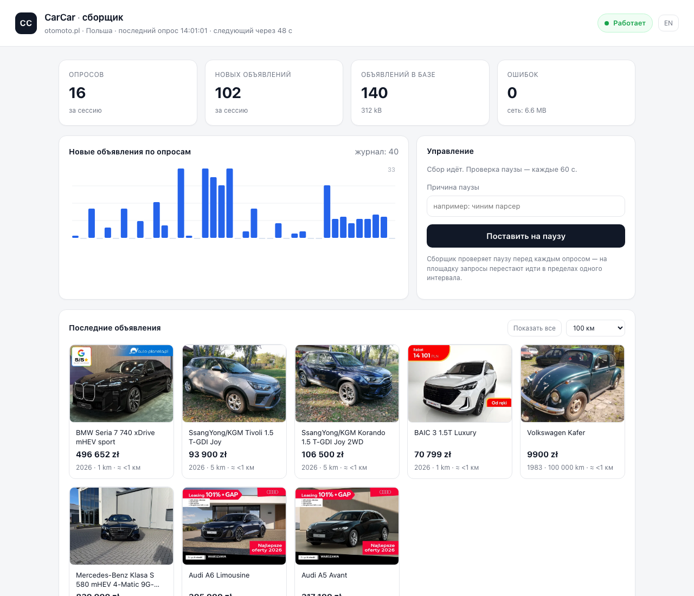
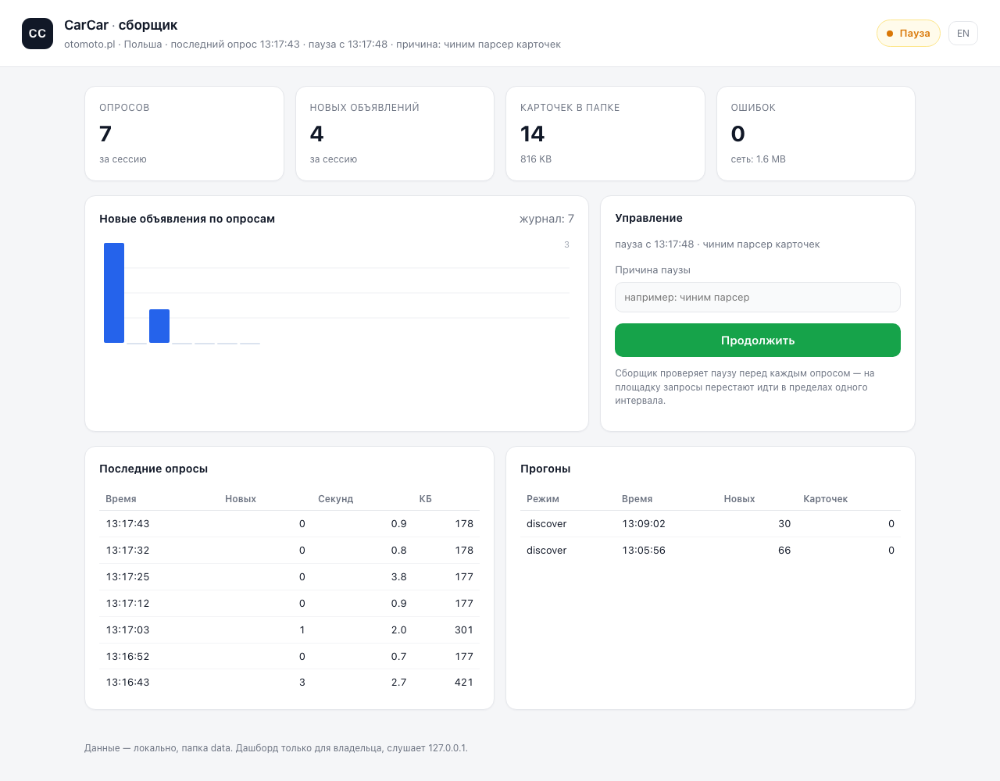
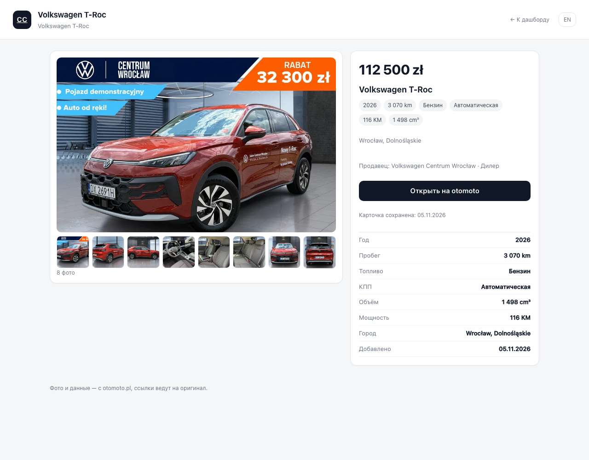

# CarCar

Агрегатор автомобильных объявлений из Польши с уведомлениями в Telegram
(Mini App + бот). Собираем открытые данные площадок, нормализуем, храним у себя,
показываем и обрабатываем в приложении.

**Статус: планирование.** Кода приложения ещё нет — есть разведка источников,
архитектура, черновик схемы БД, замеры задержки и стандарты прод-готовности
(i18n, безопасность, ошибки, наблюдаемость, поддержка).

## Документы

| Файл | Что внутри |
|---|---|
| [`docs/PLAN.md`](docs/PLAN.md) | продукт, границы MVP, архитектура, стек, модель данных, план по фазам, риски, открытые вопросы |
| [`docs/SOURCES.md`](docs/SOURCES.md) | разведка площадок: что отдаётся, чем, объёмы, `robots.txt`, что делать с OLX/Allegro |
| [`docs/LATENCY.md`](docs/LATENCY.md) | горячий путь «публикация → сообщение»: бюджет задержки, поллинг, двухфазная обработка, мониторинг |
| [`docs/I18N.md`](docs/I18N.md) | 4 языка, ICU-каталоги, плюрализация, паритет ключей, форматирование |
| [`docs/SECURITY.md`](docs/SECURITY.md) | модель угроз, аутентификация, RODO, сроки хранения, права пользователя, секреты |
| [`docs/PRODUCTION.md`](docs/PRODUCTION.md) | SLO, контракт ошибок, надёжность, наблюдаемость, загрузки, поддержка, процесс, бэкапы |
| [`db/schema.draft.sql`](db/schema.draft.sql) | черновик схемы PostgreSQL (объявления, кластеры авто, история цен, подписки, уведомления) |
| [`scripts/probe_otomoto.py`](scripts/probe_otomoto.py) | пробный сборщик otomoto: выдача и карточка, только стандартная библиотека |
| [`scripts/latency_probe2.py`](scripts/latency_probe2.py) | замер задержки публикации: поллинг выдачи, распределение «createdAt → увидели» |
| [`docs/PERF-collector.md`](docs/PERF-collector.md) | аудит производительности сборщика: замеры «до/после», находки, проверка |

## Сборщик otomoto

```bash
python3 -m venv .venv && .venv/bin/pip install -e ".[dev]"   # один раз, из корня репозитория
.venv/bin/python -m carcar discover --pages 2      # выдача → data/otomoto/discovered.ndjson
.venv/bin/python -m carcar collect --details 5     # выдача + карточки новых
.venv/bin/python -m carcar watch --minutes 30      # цикл опроса (как в проде)
.venv/bin/python -m carcar detail --id 6151080882  # одна карточка
.venv/bin/python -m carcar stats                   # что уже лежит на диске
```

Что делает и почему так:

- ходит обычным HTTP с браузерным UA, **1 запрос в секунду** — осознанный предел;
- brotli + keep-alive: страница 177 КБ вместо 1.7 МБ (замер — `scripts/bench_fetch.py`);
- атомарная запись (tmp + `os.replace`), при обрыве не остаётся полуфайлов;
- повторный запуск **не дублирует** данные: карточки по id, просмотренные id
  в `data/state/`, новые строки — только в append-only ndjson;
- карточка пишется как есть (`data` = объект `advert` целиком), чтобы потом можно
  было переиграть нормализацию без повторного похода на площадку.

```
data/
  otomoto/
    listings/2026-11-05/<id>.json   # полный ответ карточки (JSON, не HTML)
    discovered.ndjson               # строки выдачи, только новые
  state/otomoto_seen.txt            # id, которые уже видели
  runs/<timestamp>.json             # сводка каждого прогона: запросы, байты, ошибки
```

Тесты и линтер:

```bash
.venv/bin/python -m pytest        # парсер/хранилище/клиент, без сети
.venv/bin/ruff check .
```

### Полный обход и обогащение

Инкрементальный опрос видит только новые объявления. Чтобы забрать рынок
целиком, есть отдельные команды:

```bash
.venv/bin/python -m carcar sweep --rps 0.7 --minutes 300   # весь рынок постранично
.venv/bin/python -m carcar enrich --limit 500              # фото/кузов/цвет/продавец
```

- `sweep` идёт по страницам выдачи, прогресс пишет в `data/state/sweep.json`
  и продолжает с того же места после перезапуска. Полный рынок — ~8 048 страниц.
- `enrich` догружает карточки тем, у кого их нет; приоритет — свежие объявления.
- `404/410` от площадки → объявление помечается `removed` и уходит из очереди,
  а не качается бесконечно.
- Одна битая строка больше не роняет пачку: при ошибке батч переписывается
  по одной, причина отказа — в `ingest_reject`.

Прогресс обхода виден в дашборде рядом с размером базы: `обход 90/8048`.

### Надёжность сборщика

- `scripts/run_collector.sh` держит сборщик живым: перезапускает после падения
  (лог — `logs/collector.log`). Запуск: `nohup ./scripts/run_collector.sh >/dev/null 2>&1 &`.
- При ошибках — экспоненциальный бэкофф: 60 → 120 → 240 → 480 → 600 с,
  сбрасывается после успешного опроса.
- **После 5 ошибок подряд сборщик сам ставит паузу** с причиной в
  `control.json` — чтобы не долбить площадку. Снять: кнопка в дашборде или
  `python -m carcar resume`.
- На `429`/`503` клиент ждёт 10–20 с перед повтором и уважает `Retry-After`:
  троттлинг площадки не превращается в шторм запросов.

## База данных (Supabase)

По умолчанию парсер **не хранит объявления у тебя на диске** — он пишет
канонические строки в Postgres. Локальная папка остаётся для офлайна (`--file`)
и для служебного состояния (heartbeat, пауза, журнал опросов).

Схема — [`carcar/schema.sql`](carcar/schema.sql), применяется идемпотентно:

```bash
.venv/bin/python scripts/apply_schema.py
```

| Таблица | Зачем |
|---|---|
| `source` | площадки (otomoto, olx, …) |
| `listing` | объявления: один набор полей для всех источников |
| `listing_event` | история цены и статуса — только при изменении |
| `crawl_run` | прогоны: страницы, новые, обновлённые, ошибки |
| `ingest_reject` | отбраковка с причиной (не мусор в основной таблице) |

### Как не забить базу мусором

- **Уникальность** `(source_id, external_id)` — повторный сбор не создаёт дублей.
- **Хэш содержимого**: если ничего не изменилось — обновляется только
  `last_seen_at`, строка не перезаписывается.
- **История только на изменения**: `listing_event` пишется при падении/росте
  цены или снятии, а не на каждом опросе.
- **Никакого сырого JSON и HTML** — только канонические поля. Описания
  не храним: для фильтра и уведомления они не нужны.
- **Фото — только URL, до 60 на объявление**, без байтов. Хранится столько,
  сколько отдала площадка (обычно 15–40), а не обрезанные 8.
- **Валидация до записи**: нет цены, битый id, неполный URL, нулевой пробег —
  запись уходит в `ingest_reject` с причиной.
- **Ретенция**: `carcar_purge()` удаляет снятые объявления старше 30 дней,
  прогоны старше 90, отказы старше 30, события старше 180.
- **RLS включён**: `anon`/`authenticated` по умолчанию не видят ничего.

### Команды

```bash
.venv/bin/python -m carcar discover          # пишет в базу
.venv/bin/python -m carcar collect --details 5
.venv/bin/python -m carcar stats             # счётчики + размер таблиц
.venv/bin/python -m carcar purge --days 30   # чистка старых записей
.venv/bin/python -m carcar discover --file   # локальный режим, без базы
```

Строка подключения — в `.env.supabase` (Session pooler, IPv4; файл в `.gitignore`).

## Гео и расстояние

У объявления есть координаты:

- **точные** — из карточки (`seller.location.map`), когда карточка скачана;
- **по городу** — из офлайн-справочника GeoNames (47 710 населённых пунктов,
  с алиасами: «Warszawa» находит «Warsaw»), если карточки ещё нет.

Справочник лежит в `carcar/geo/pl_places.tsv.gz` (845 КБ) и собирается скриптом
`scripts/build_geo.py` из дампа GeoNames (лицензия CC BY 4.0). Никаких запросов
к Nominatim на каждое объявление — поиск идёт в памяти, ~микросекунды.

В дашборде: кнопка «Рядом со мной» (геолокация браузера), радиус 25/50/100/200 км
или вся Польша; на плитках появляется расстояние, в карточке — «≈ 259 км от вас».
Координаты хранятся в localStorage браузера, на сервер уходят только как
параметры запроса и не логируются.

Ссылку с координатами можно открыть напрямую (удобно для проверки):
`http://127.0.0.1:8077/?lat=52.23&lon=21.01&radius=100`.

## Как работает парсер

Подробно: [`docs/PARSER.md`](docs/PARSER.md). Коротко — три прохода:
инкремент (каждые 60 с, 2 страницы), обогащение (карточки с фото) и полный обход
(8 051 страница, прогресс в базе). Всё пишется в каноническую схему через upsert
с хэшем содержимого — без дублей и без перезаписи неизменившегося.

## Telegram Mini App

Фронт — **Next.js 15 + shadcn + Phosphor** на Vercel, API и бот — отдельные
сервисы Railway. Четыре экрана: главная, список с фильтрами, объявление
(с оценкой рынка, отметкой о снижении цены и похожими авто), аккаунт
с сохранёнными фильтрами и избранным. Авторизация — Telegram initData
(HMAC) → JWT. Подробно: [`docs/MINIAPP.md`](docs/MINIAPP.md).

## Деплой: Railway, по сервису на площадку

Каждый коллектор — самостоятельный сервис с общим образом и общей базой:
`CARCAR_MODE=watch|enrich|sweep|dashboard`, `CARCAR_SOURCE=otomoto|...`.
Состояние (heartbeat, пауза, прогресс обхода) — в Supabase, поэтому контейнеры
stateless. Подробно: [`docs/RAILWAY.md`](docs/RAILWAY.md).

```bash
# сборка образа
docker build -t carcar .

# локальная проверка режимов
docker run --rm -e DATABASE_URL=... -e CARCAR_MODE=watch -e CARCAR_SOURCE=otomoto carcar
```

## Дашборд



```bash
.venv/bin/python -m carcar watch --minutes 240     # сборщик пишет heartbeat каждые 60 с
.venv/bin/python -m carcar dashboard               # http://127.0.0.1:8077, данные из базы
.venv/bin/python -m carcar dashboard --file        # то же на локальных файлах
.venv/bin/python -m carcar pause --reason "чиним парсер"
.venv/bin/python -m carcar resume
```

Что видно:

- **статус** (работает / пауза / нет связи / не запускался), последний и следующий
  опрос, число опросов и новых объявлений за сессию, ошибки;
- **база**: сколько объявлений, размер таблицы;
- **метрики**: собрано за сегодня / 7 / 30 дней, число платформ;
- **графики**: новые объявления по дням (30) и по месяцам (12), столбики
  раскрашены по площадкам — «стекло» сразу показывает, кто сколько дал;
- **таблица платформ**: активные, сегодня, 7 и 30 дней, всего, медианная цена;
- **фильтр по площадке** и по расстоянию — в шапке ленты;
- журнал опросов и прогонов, плитки последних объявлений, карточка с фото.

Данные объявлений дашборд читает из **Postgres (Supabase)**: список, карточка,
фильтр по расстоянию, метрики и счётчики. Всё через таблицу `source`, поэтому
рядом с otomoto автоматически появятся OLX и следующие площадки — без правок UI. Файлы остаются офлайн-режимом (`--file`) и
служебным состоянием — heartbeat, пауза, журнал опросов:

```
data/state/heartbeat.json   ← пишет сборщик (статус, метрики, следующий опрос)
data/state/control.json     ← пишет дашборд (пауза, причина, кто и когда)
data/state/polls.ndjson     ← журнал опросов для графика (обрезается до 500 строк)
```

Сборщик проверяет паузу **перед каждым опросом**: запросы на площадку
прекращаются в пределах одного интервала, а пауза переживает перезапуск обоих
процессов. Если heartbeat не обновлялся дольше четырёх интервалов — статус
«Нет связи» и подсказка, что запускать.



### Карточка объявления



Клик по плитке открывает `/listing/<id>`: галерея со **всеми фото** (лента
миниатюр прокручивается, клик меняет главное), цена, чипы характеристик,
таблица параметров, продавец и кнопка на оригинал.

Если карточка ещё не обогащена (сборщик качает `--details` штук на опрос), на
странице есть кнопка «Загрузить карточку»: дашборд сходит на площадку один раз
и запишет фото, VIN и точные координаты в базу.

Описания в базе не хранятся (это лишние килобайты на каждое объявление),
поэтому в карточке их нет — кнопка «Открыть на otomoto» ведёт на оригинал.

Фото — прямые ссылки на CDN площадки (`referrerpolicy="no-referrer"`), к себе
не копируем: это и позиция по правам, и экономия диска.

Дашборд слушает только `127.0.0.1` — наружу не выставлен. Для доступа с другого
устройства понадобится туннель и авторизация (пока их нет).

## Быстрая проверка источника

```bash
python3 scripts/probe_otomoto.py                    # страница выдачи: 32 объявления
python3 scripts/probe_otomoto.py --pages 3          # три страницы
python3 scripts/probe_otomoto.py --detail "https://www.otomoto.pl/osobowe/oferta/renault-megane-ID6Ihj7Y.html"
```

Скрипт ходит обычным HTTP-запросом (без браузера), разбирает
`<script id="__NEXT_DATA__">` и печатает нормализованные строки.
Тормозит себя до 1 запроса в секунду — это осознанное ограничение, не баг.

## Факты на 05.11.2026

- otomoto.pl: **257 382** объявления «osobowe», 32 на страницу, полный JSON
  уже в HTML — браузер и прокси не нужны.
- Brotli: **182 КБ** вместо 1.76 МБ — частый поллинг дешёвый.
- OLX и Allegro: **403** (CDN-защита) — нужен браузер/прокси или официальный API.
- Полный обход otomoto: ~8 044 страницы, ~13.7 ГБ HTML, ~2.2 ч при 1 req/s.
- Новые объявления появляются в выдаче с задержкой площадки ~1–1.5 мин
  (замер), наш участок «увидели → отправили» — секунды.

Подробности и цифры — в [`docs/SOURCES.md`](docs/SOURCES.md) и
[`docs/LATENCY.md`](docs/LATENCY.md).

## Следующий шаг

Согласовать развилки из раздела 15 [`docs/PLAN.md`](docs/PLAN.md) и начать фазу 1:
коллектор otomoto + схема БД + нормализация.
